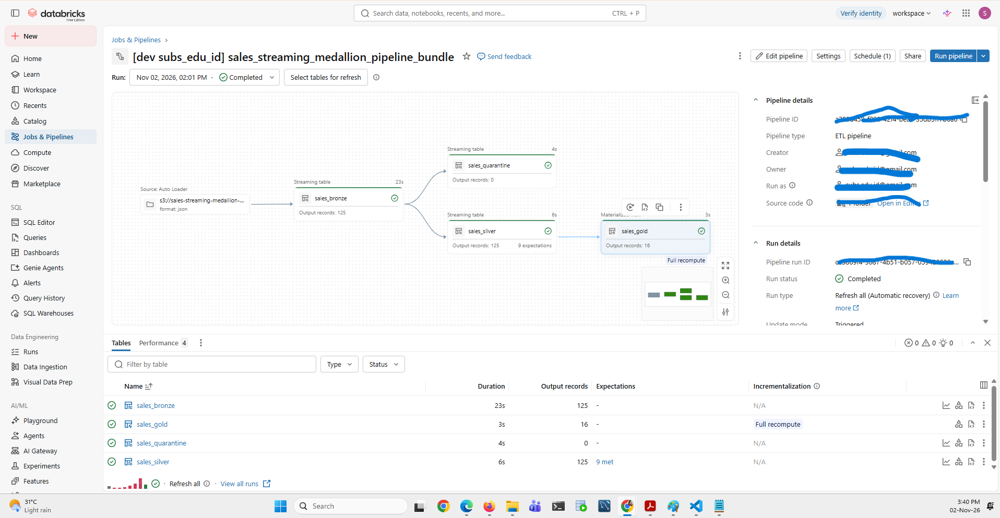
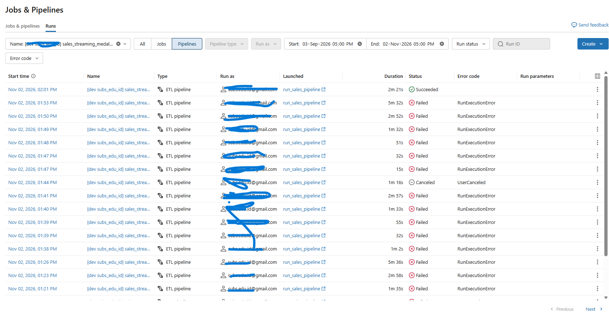
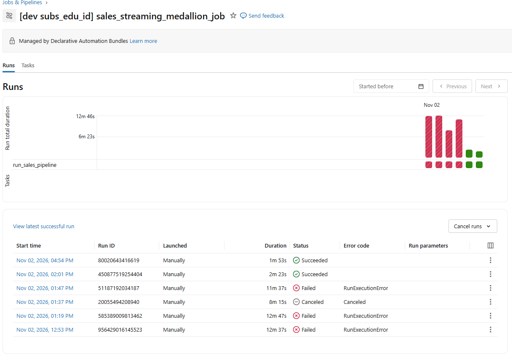
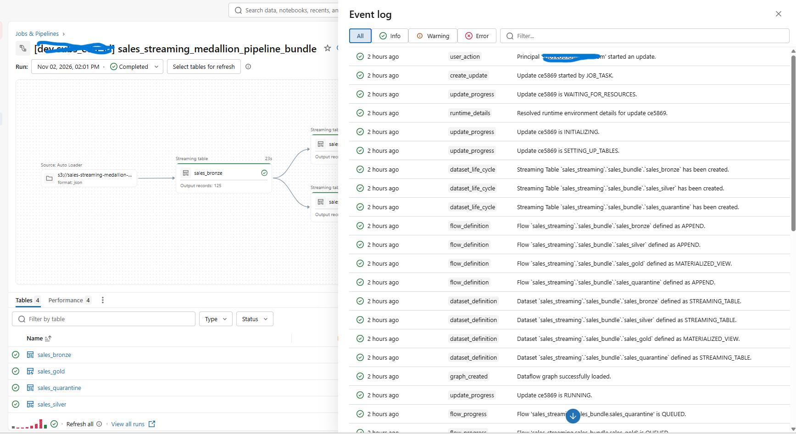
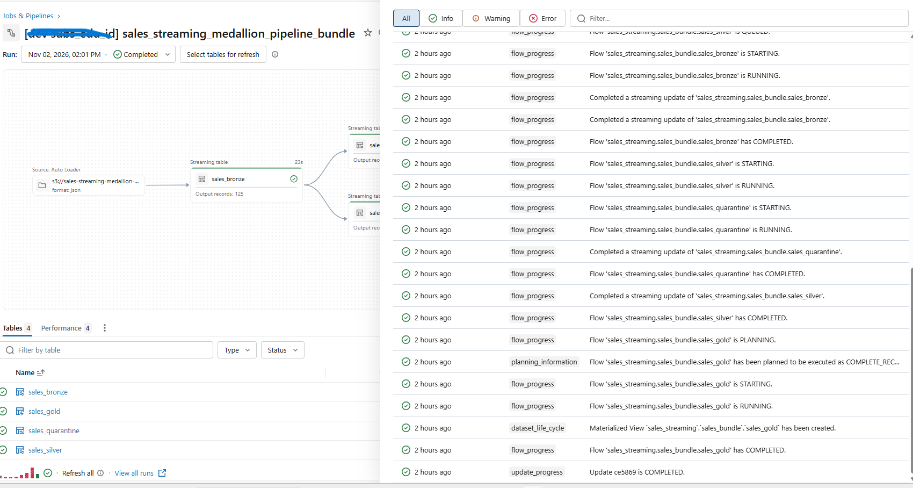
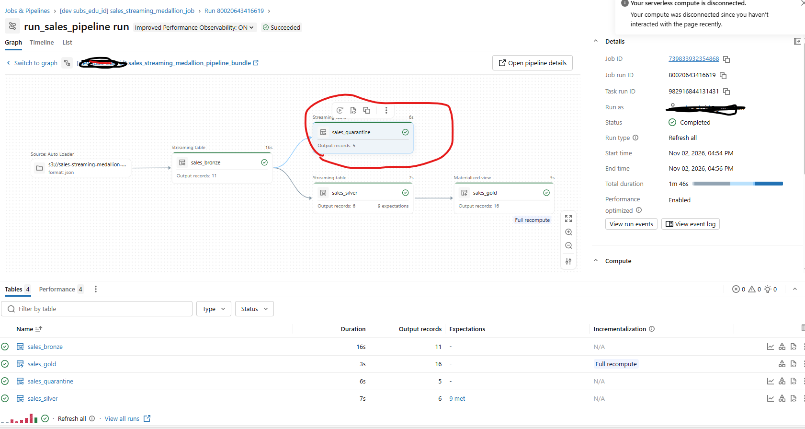
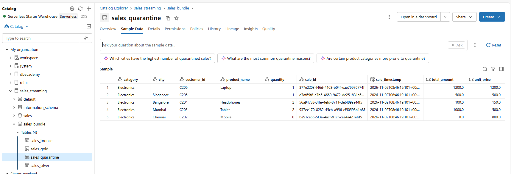
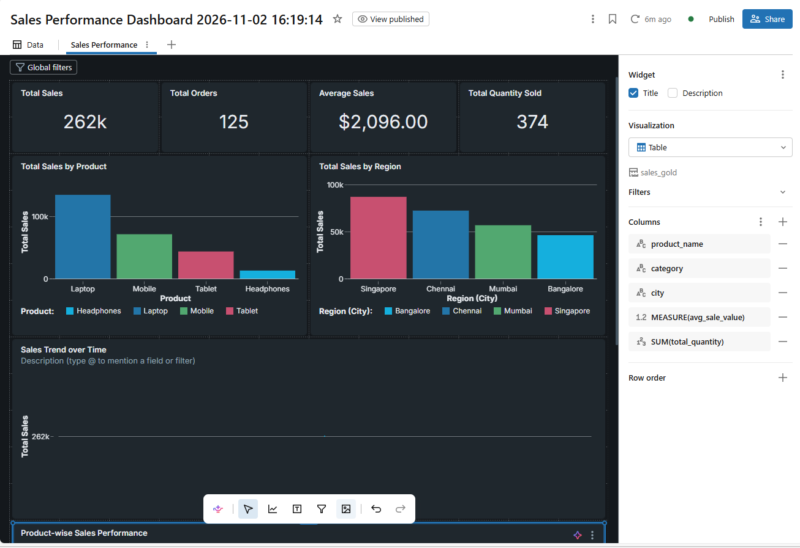
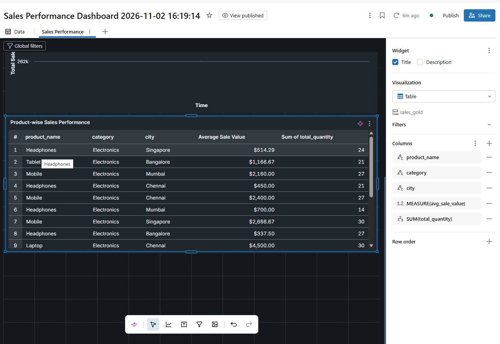
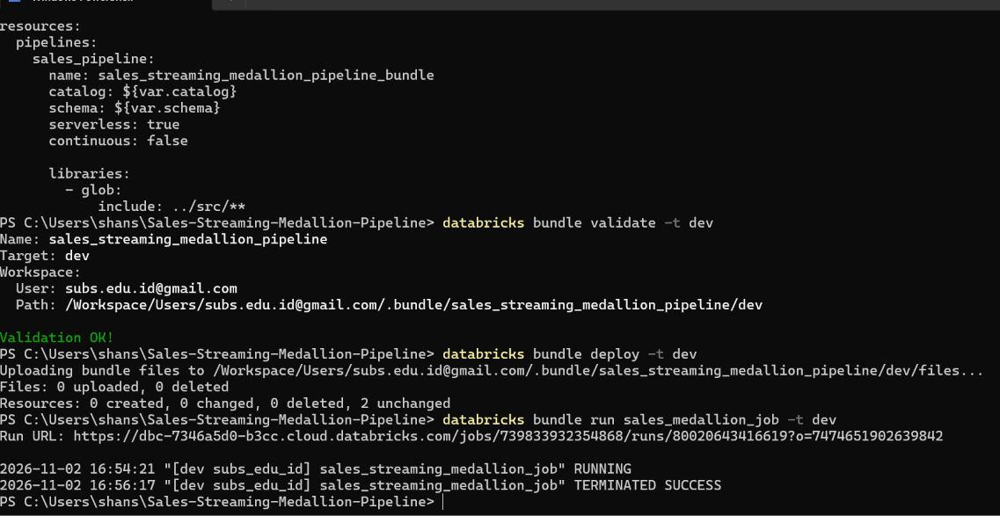

# 📸 Sales Streaming Medallion Pipeline – Execution Screenshots

This folder contains screenshots demonstrating the architecture, implementation, execution, monitoring, data quality validation, quarantine handling, and analytical output of the **Sales Streaming Medallion Pipeline** built using Databricks and Databricks Asset Bundles.

The screenshots provide evidence of the end-to-end data engineering workflow, from incremental ingestion using AWS S3 and Databricks Auto Loader to data transformation and Gold-layer analytics.

---

## 1. Pipeline Architecture and Execution

### 01 – Pipeline Graph

Shows the overall pipeline architecture and the Bronze, Silver, Gold, and Quarantine data processing flow.

### 03 – Successful Pipeline Run

Demonstrates successful execution of the Databricks pipeline.

### 07 – Pipeline Run Log

Shows job execution details, task status, and pipeline run information.

---

## 2. Event Logs and Monitoring

Databricks pipeline event logs provide visibility into pipeline execution and processing activities.

### 02 – Pipeline Event Log 1

Shows pipeline initialization, resource setup, and execution events.

### 02 – Pipeline Event Log 2

Provides additional event information useful for monitoring and troubleshooting pipeline execution.

---

## 3. Data Quality Validation and Quarantine

To test the data quality implementation, a separate test batch containing six sales records was generated and uploaded to the existing AWS S3 incoming folder.

The test batch included both valid and invalid records to verify the validation rules implemented in the Silver layer.

### Test scenarios

| Test scenario | Expected result |
|---|---|
| Valid sales record | Accepted |
| Zero quantity | Invalid |
| Negative unit price | Invalid |
| Incorrect total amount | Invalid |
| Missing product name | Invalid |
| Missing city | Invalid |

### Processing workflow

1. The six test records were uploaded to the existing S3 incoming folder.
2. Databricks Auto Loader detected and ingested the new data into Bronze.
3. The Silver layer applied the configured data quality validations.
4. Invalid records were separated and directed to the Quarantine table.
5. Valid records continued through the Silver and Gold processing layers.

### 06 – Quarantine: Invalid Records

Demonstrates the handling of records that fail the configured data quality validations.

### 08 – Quarantine Records Table

Shows invalid records captured in the Quarantine Delta table through Databricks Catalog Explorer.

This approach prevents invalid records from silently entering downstream analytical datasets and allows them to be investigated separately.

---

## 4. Gold Layer and Analytics

The Gold layer contains transformed and aggregated sales data prepared for analytical consumption.

It provides business-ready datasets that can be used for reporting and dashboard development.

The pipeline's materialized view dependencies and transformation flow can also be inspected through the Databricks pipeline interface.

---

## 5. AI/BI Dashboard

The Databricks AI/BI dashboard uses the processed Gold-layer data to present sales-related analytics and visualizations.

### 04 – AI/BI Dashboard 1

First view of the sales analytics dashboard.

### 04 – AI/BI Dashboard 2

Additional dashboard visualizations based on the processed sales data.

---

## 6. Databricks Asset Bundles – Deployment

### 05 – Databricks Asset Bundles CLI

Demonstrates the use of the Databricks CLI to validate, deploy, and run the project using Databricks Asset Bundles.

The project is organised using:

- `databricks.yml` – central bundle configuration.
- `resources/` – Databricks resource definitions.
- `src/` – pipeline implementation code.
- `tests/` – test and validation code.

This configuration-driven approach supports repeatable deployment and organised management of Databricks resources.

---

## 7. Technology Stack

| Technology | Purpose |
|---|---|
| Databricks | Data engineering platform |
| PySpark | Distributed data processing |
| Structured Streaming | Streaming data processing |
| Auto Loader | Incremental file ingestion |
| Delta Lake | Reliable data storage |
| Lakeflow Spark Declarative Pipelines | Pipeline development and execution |
| Lakeflow Jobs | Job orchestration |
| Databricks Asset Bundles | Resource configuration and deployment |
| AWS S3 | Cloud object storage |
| Python | Data generation and pipeline development |
| Git and GitHub | Version control and project documentation |

---

## 8. Project Objective

The objective of this project is to build an incremental sales data ingestion and transformation pipeline using a Medallion Architecture.

The implementation demonstrates:

- Incremental ingestion from AWS S3 using Databricks Auto Loader.
- Bronze, Silver, and Gold data processing.
- Data quality validation and invalid record quarantine.
- Delta Lake-based data storage.
- Pipeline orchestration and execution monitoring.
- Configuration-driven deployment using Databricks Asset Bundles.
- Gold-layer analytical data and dashboard development.

**Note:** These screenshots document the implemented project workflow and execution evidence. For the complete project overview, architecture, repository structure, and implementation details, refer to the [main project README](../README.md).
