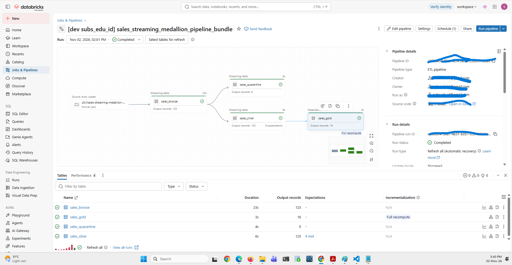
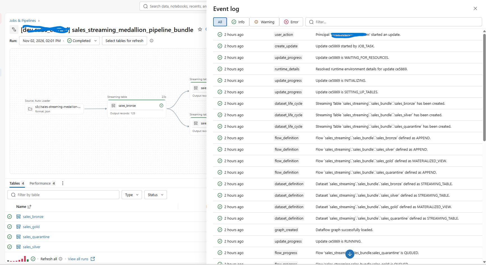
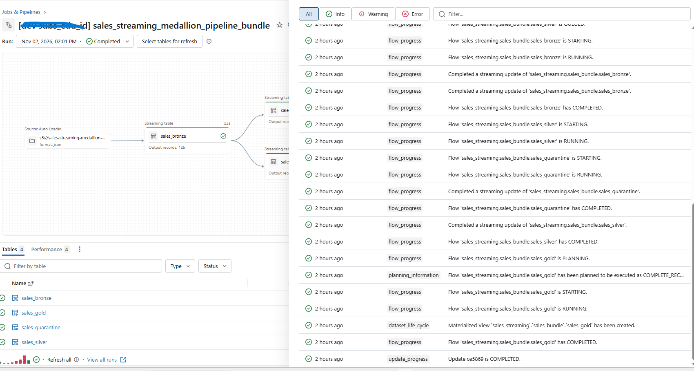
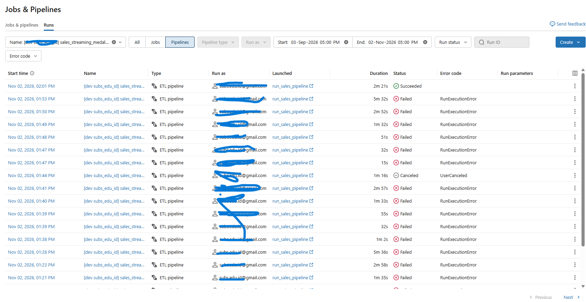
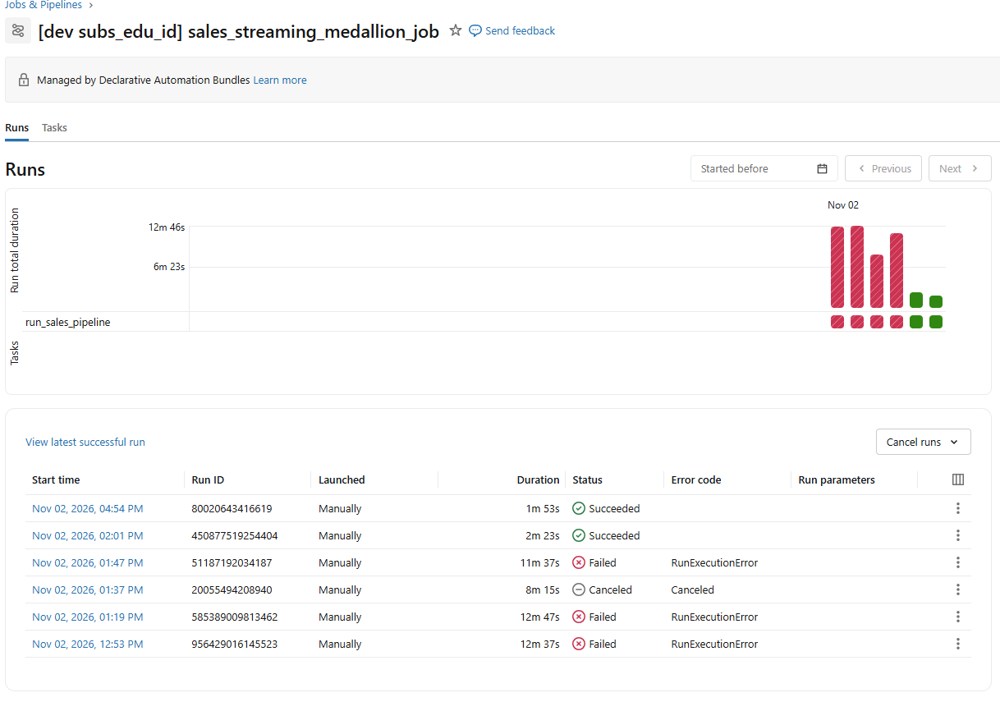
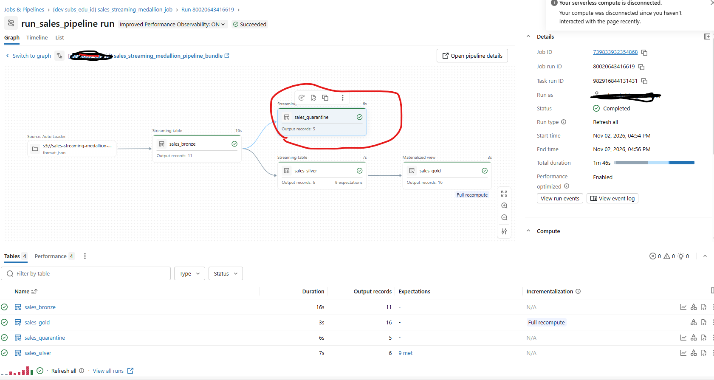
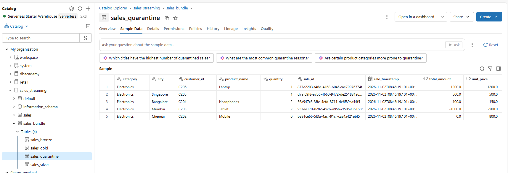
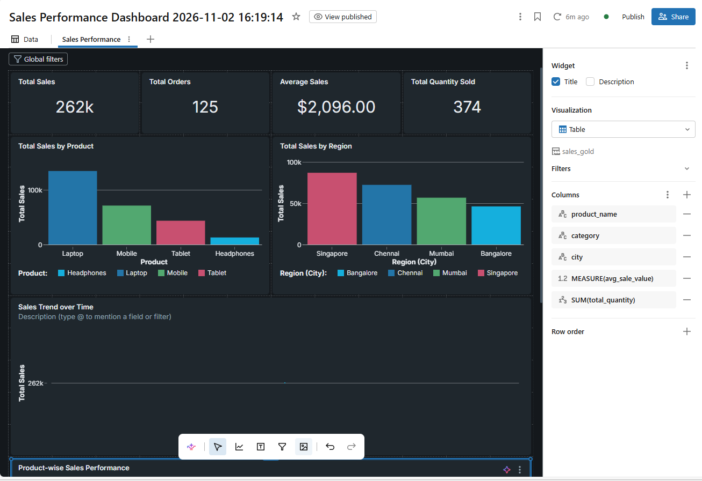
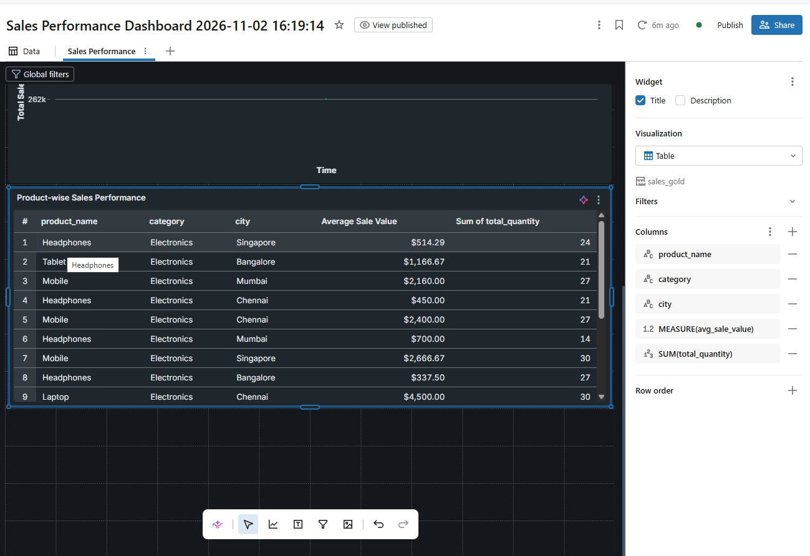
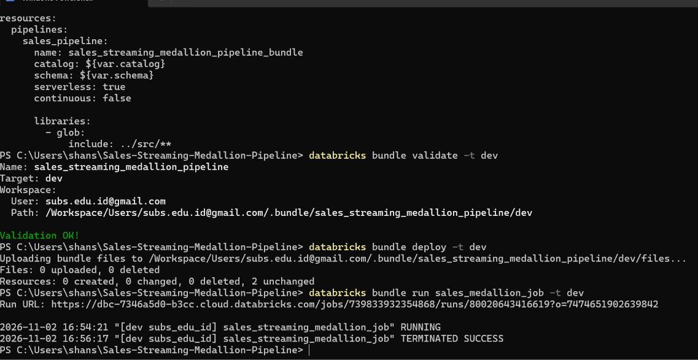

# Sales-Streaming-Medallion-Pipeline
# 📸 Project Execution Screenshots

This folder contains screenshots demonstrating the implementation, execution, monitoring, and output of the **Sales Streaming Medallion Pipeline** built using Azure/AWS storage integration, Databricks Auto Loader, Delta Lake, and Databricks Asset Bundles.

## 1. Pipeline Architecture

### 01 – Pipeline Graph

Overview of the Databricks pipeline structure and the execution flow across the Bronze, Silver, and Gold layers.

## 2. Pipeline Monitoring

### 02 – Pipeline Event Log

First view of the pipeline event log, showing execution events and pipeline activity.

Additional event log details for monitoring pipeline execution and processing activity.

### 03 – Successful Pipeline Run

Evidence of a successful pipeline execution.

### 07 – Pipeline Run Log

Task-level execution details and run status for the Databricks pipeline job.

## 3. Data Quality and Quarantine

### 06 – Quarantine: Invalid Records

Screenshot demonstrating the handling of invalid records through the quarantine process.

### 08 – Quarantine Records Table

Quarantined records stored in a Delta table for inspection and further analysis.

## 4. Analytics Dashboard

### 04 – AI/BI Dashboard

First view of the dashboard presenting sales-related analytics.

Additional dashboard view highlighting the analytical outputs of the pipeline.

## 5. Deployment and CI/CD

### 05 – Databricks Asset Bundles CLI

Command-line evidence of Databricks Asset Bundles operations used to validate, deploy, and run the project in the development environment.

---

**Note:** These screenshots document the implemented project workflow and its execution evidence. Refer to the main [README](../README.md) for the project overview, architecture, technologies, and implementation details.
